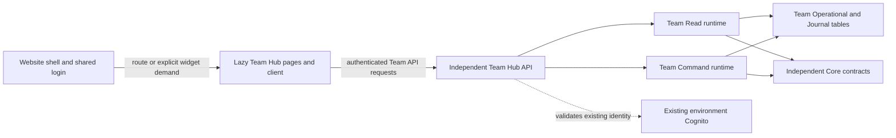

# Team Hub separation: worked example and repeatable procedure

This is the practical companion to the [domain architecture standard](project-respawn-domain-architecture-standard.md), [new-domain checklist](new-domain-checklist.md) and [migration-control README](README-PHASE2-MIGRATION.md). Those documents remain the governing rules. This guide explains what Team Hub separated, how to verify it, and how to apply the pattern to another coherent product domain. It does not authorize deployment, data migration or publication.

## What “independent” means

There are three separate milestones. A folder move or successful infrastructure deployment does not complete all three.

| Boundary | Required behavior | Team Hub status |
| --- | --- | --- |
| Frontend loading | The website shell registers lightweight routes; pages, product clients and stores load only when an authorized journey or explicit widget needs them. | Lazy route/page and import-boundary checks pass. Localhost selects the accepted independent Ntgre client. |
| Backend deployment | A product has its own sibling CloudFormation root, API, runtimes, runtime/deployment IAM and owned resources. Deploying it does not select the Legacy root. | Ntgre and Production have independent product/security roots. Production is deployed dark. |
| Business authority/data | Existing records and writers are reconciled; one authoritative writer is enforced; the frontend selects the accepted endpoint only after live acceptance. | Ntgre cutover accepted. Production remains LEGACY_WRITER 1/1 with no target business records; production migration and public activation remain pending. |

AWS stacks are provisioned infrastructure. They do not download when a page opens. JavaScript chunks load on demand; those pages then call the product's API, whose Lambda runtime runs on demand. The shared website shell, login and approved Core contracts may be common dependencies. A homepage Team summary is an explicit consumer of Team Hub, not permission to initialize every product at login.

The target is one website with independently loaded product sections and independently released backend domains. It is not a new stack for every page, tab or small feature, and it does not require a separate frontend application for each domain.

## Team Hub's actual boundaries



The diagram describes the independent path. The public Production website still uses its Legacy path until the separately authorized migration and frontend activation. Keeping that path temporarily is state preservation, not an instruction to add new Team behavior to Legacy.

| Item | Ntgre | Production |
| --- | --- | --- |
| Product root | `ProjectRespawn-TeamHub-Ntgre` — 48 resources | `ProjectRespawn-TeamHub-Production` — 42 resources |
| Security root | `ProjectRespawn-TeamHub-Ntgre-ReadProofSecurity` — 7 resources | `ProjectRespawn-TeamHub-Production-Security` — 8 resources |
| Team API | `t54b88casf` | `9wk4a41l5m` |
| Authority | Accepted TARGET_WRITER 5/5 | Verified LEGACY_WRITER 1/1 |
| Frontend selection | Accepted localhost Ntgre binding | Public website still Legacy; independent production activation held |

The differing counts reflect accepted environment-specific releases. Do not normalize them, reuse Ntgre identities in Production, or treat a count match alone as proof of equivalence. The product/security roots have no CloudFormation parent and contain no nested stacks. Cognito is reused rather than recreated. Core is an explicit contract dependency, not a shared business Lambda or a foreign-table permission.

## Where the implementation lives

| Concern | Repository location and purpose |
| --- | --- |
| Pages and route declarations | `src/features/Team Hub/`; `team-hub.routes.js` uses dynamic page imports. Keeping route metadata in the shell is acceptable. |
| Client, adapters and service selection | `src/features/team-hub/api/` and `services/`; the router imports access/service logic dynamically. |
| Local environment selection | `scripts/lib/team-hub-local-binding.mjs` and `vite.config.js`; aliases apply only to `serve`, validate the existing Ntgre identity/manifests, and fail closed. |
| Environment/endpoint and activation contracts | `config/domains/team-hub/`; endpoint discovery and permission to activate are different artifacts. Production `PROPOSED` files remain unactivated and must not be mistaken for deployed endpoint discovery. |
| Business logic, authority and contracts | `domains/team-hub/`; dedicated Read/Command behavior, transactional authority/membership/revision checks, audit, idempotency and private data rules. |
| Independent infrastructure source | `infrastructure/domains/team-hub/app.ts`, `stack.ts` and its package/toolchain. The entrypoint constructs sibling roots without instantiating LegacyPlatform. |
| Actual accepted production artifacts | `docs/architecture/team-hub-production-migration-2026-10-24/runtime-candidate/` and its actual `execution/` receipts. The earlier permission/tagging candidates remain historical and compatible pre-write rollback evidence. |
| Current production authority receipt | [C1 result](team-hub-production-c1-result.md) and its execution history/readback/cleanup evidence. |
| Independent release controls | Exact artifact manifests, scoped caller/execution roles, inspected change sets and environment-specific runbooks. Historical scripts are not generic deployment authorization. |

Some main-tree authority/infra examples are historical Ntgre sources. Production uses its accepted pinned source closure and artifacts. Do not deploy current HEAD, rebuild an approved ZIP or replace exact artifact bindings simply because source files look similar.

### Local test identities and production verification

Normal `npm run dev` uses the protected **Ntgre** outputs and existing `respawn.test` Admin/SuperAdmin and persona accounts. Keep personal production identities out of development configuration; never repoint `amplify_outputs.json` or the normal dev server to Production to make a test pass. Run `npm run validate:local-outputs` before local work.

A separately labelled, temporary production-acceptance helper is an explicit exception for verifying the real production API. It must use the existing production pool/client, a separate loopback origin/port, memory-only sessions, no normal-dev configuration changes and prompt cleanup. Prefer `127.0.0.1` for future production helpers so the hostname is distinct from normal `localhost` testing. A production helper signing in successfully does not make the localhost app or public website production-activated. The 24 October helper was closed after actual authority/19-route dark acceptance; no account was created and no production credentials were added to local configuration.

## Repeat this process for the next domain

1. **Choose the ownership boundary.** Name the capability, data owner, lifecycle and consumers. Classify it against the existing domain map. Put a module inside an existing owner when appropriate; create a sibling deployment root only when the domain's release, security, state and growth justify it. Record a frontend-only decision explicitly when no backend is needed.

2. **Inventory the current implementation and state.** Trace routes, imports, global initializers, actual API calls, Lambda consumers, generated resolvers, tables/indexes, storage prefixes, manual/privileged writers, shared roles and current physical stack ownership. Record current users/data/protections and the accepted deployment baseline. Do not equate logical ownership with physical resource ownership.

3. **Extract the frontend loading boundary.** Give the domain a route/page/client/store boundary. Use dynamic imports for major pages and service/access logic; keep product stores and API clients uninitialized until needed. Shared shell/auth and pure contracts are allowed. Ensure importing a route list does not import all pages or start requests. Keep existing URLs, role guards and deep links. An unrelated section must not load this domain's implementation, and this domain must not import unrelated products.

4. **Define versioned owner contracts.** Specify environment, trusted subject, API/auth modes, global versus resource authorization, privacy, request/response errors, pagination, revisions, idempotency, audit and dependency failures. Use bounded Core contracts instead of direct Cognito administration or foreign database access. A shared login is not shared authorization. Do not expose provider credentials or a generated global business client through the shell.

5. **Prepare independent roots and security.** Build/synthesize only the selected domain's input closure into a fresh isolated assembly. Own its runtimes, API and required data/storage; preserve existing identity. Separate runtime, deployment caller and CloudFormation execution permissions. Scope trust/resources/PassRole and artifact access. Count all generated, custom, IAM, API, log and nested resources. A nested `backend.createStack()` under LegacyPlatform is not an independent root.

6. **Bind the exact environment and release artifacts.** Verify account/region, existing Cognito issuer/client, real Core contract and domain API/table/key/secret identities. Pin source closure, runtime/template/manifest SHA-256 and compatible rollback references. Preserve immutable bytes across Git checkouts. Resolve supported AWS lifecycle permissions from documentation and demonstrated service behavior; test explicit Deny interactions and policy-size limits. Never copy Team Hub's role/key/API ARNs, epoch or historical exceptions into another release.

7. **Validate offline and review the concrete deployment.** Run relevant contract, authorization/privacy, concurrency/idempotency, IAM positive/negative, Access Analyzer, TypeScript/build, resource-accounting, migration-ledger and secret checks. Prove frontend static import boundaries. Record simulator limits. Prepare expected changes and rollback. Deploy only after separate authorization and full change-set inspection; frontend-only publication must not select backend deployment.

8. **Deploy and accept a dark backend first.** Verify actual installed policies/boundaries/trust, code hashes, complete environments, resource identities, service initialization and real metrics. Compare unrelated infrastructure and source data. Keep existing business authority and the frontend unchanged. Missing authority or a denied dark business route is not justification to bypass checks. Keep initialization/bootstrap separately fixed and authorized when required.

9. **Transfer existing state through its own maintenance gate.** Prove backups/restores, original-principal writer fences, drained writes and storage audit/quarantine; obtain a consistent final export. Transform deterministically, conditionally import and reconcile identities, relationships, counts and digests. Enforce a single writer using conditional monotonic authority transitions. Team Hub mutations check real Journal authority/epoch/version inside their DynamoDB transaction, along with authorization, revision, idempotency and audit conditions. A browser status response is not that security boundary. Late S3 completion is handled by the accepted logical-authority/quarantine model, not a claim of universal physical revocation.

10. **Activate the frontend only after live business acceptance.** Publish an accepted same-environment endpoint manifest and separately reviewed activation/rollback pin. Bind to authenticated server authority, fail closed on missing/stale/mismatched state, and retain server-side authorization. Verify real personas, all operations, privacy/revocation, dependency failures and request/log/metric correlation. After any target writes, rollback needs containment and data reconciliation; reverting frontend files alone cannot restore source authority.

11. **Observe and record the actual stage.** Preserve sanitized receipts, exact hashes, known limits and recovery custody; update migration status and the domain runbook. Verify browser network/console behavior and unchanged unrelated domains. Keep old resources until a later separately authorized retirement review. Never mark a product fully migrated merely because its new stack exists.

## How to verify Team Hub again

Read the current migration README/runbook first. The audit below performs no AWS writes, function invocation, state transition, deployment or publication. Use the approved inspection identity and do not recreate protected Ntgre infrastructure when a check fails.

```powershell
# Existing local configuration must still match protected Ntgre.
npm.cmd run validate:local-outputs

# Use a NEW evidence directory for each review; retain prior receipts unchanged.
$env:TEAM_HUB_SEPARATION_EVIDENCE = 'docs/architecture/team-hub-separation-verification-YYYY-MM-DD-review-2'
node scripts/team-hub-separation/aws.mjs
node scripts/team-hub-separation/frontend.mjs
node --test scripts/lib/team-hub-local-binding.test.mjs scripts/team-hub-permissions/production-client.test.mjs
Remove-Item Env:TEAM_HUB_SEPARATION_EVIDENCE
```

The AWS checker verifies known roots, absence of nesting/new Cognito resources, exact production templates, APIs/JWT identity, authority and runtime hashes. It pins the expected current epoch/resource release; a later accepted release requires a reviewed checker update rather than ignoring a mismatch. It is not a complete IAM, data-preservation or business-health reacceptance suite.

The frontend checker creates two fresh offline builds: current hosted-source selection and the exact Ntgre local aliases. It walks **static import closures**, allowing dynamic route declarations but excluding eager Team implementation, foreign implementations in Team pages and Team implementation in unrelated product pages. It never publishes or changes service selection. `browserNetworkAcceptance: false` is intentional: static bundle analysis is not a fresh authenticated browser journey. Follow it with actual browser checks for the environment being released: clean homepage, each product deep link, real roles, downloaded assets, API hosts, console/privacy and failure behavior. Observe requests; do not infer runtime behavior from chunk filenames.

Latest fresh verification: [AWS evidence](team-hub-separation-verification-2026-10-24/aws.json), [177 frontend closure checks](team-hub-separation-verification-2026-10-24/frontend.json). Historical Ntgre live cutover evidence remains in the migration README. Production authenticated authority/18-route dark acceptance, isolated cursor proof, nonempty migration, business transfer and Master publication are still pending; this guide does not advance those gates.
